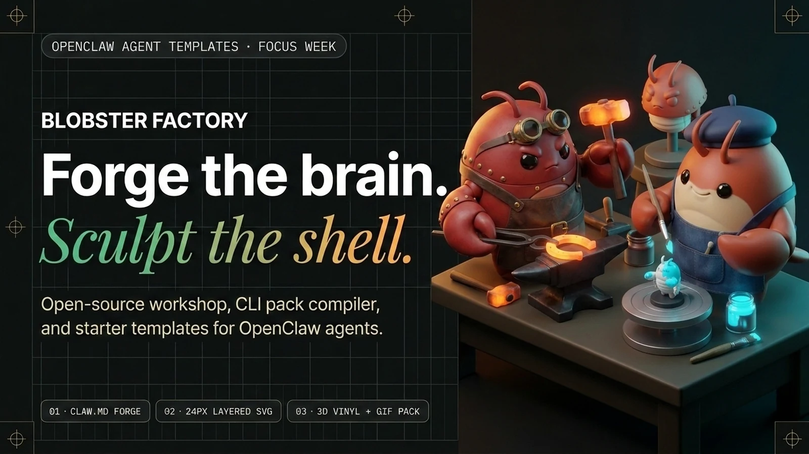
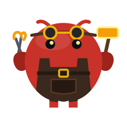
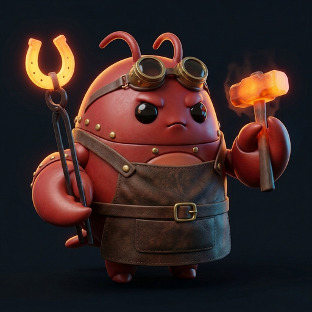
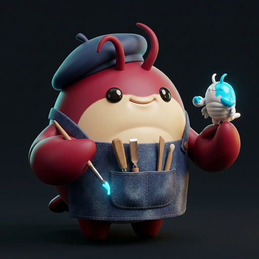

<div align="center">
  <picture>
    <source media="(prefers-color-scheme: dark)" srcset=".github/assets/banner-dark.webp">
    <source media="(prefers-color-scheme: light)" srcset=".github/assets/banner-light.webp">
    
  </picture>

  <p>
    
    
    
    
  </p>

  <p>
    <a href="#the-builder-duo">The Builder Duo</a> ·
    <a href="#two-tier-blobster-pack-architecture">2-Tier Avatar Pack</a> ·
    <a href="#quick-start">Quick Start</a> ·
    <a href="#repository-layout">Repository Layout</a> ·
    <a href="#verification">Verification</a>
  </p>
</div>

---

# Blobster Factory (`blobster-factory`)

An open-source workshop, deterministic asset compiler, template linter, and starter template collection for **[OpenClaw](https://github.com/openclaw) Agent Templates** (a single `CLAW.md` manifest, `package.json`, and `workspace/`).

Every OpenClaw agent needs two halves that fit together cleanly:
1. **The Brain (`Blobster Smith`)** — Prompts you to **name your bot** and give a **brief description**, then forges a solo-install-ready, schema-validated `CLAW.md` manifest, `BOOTSTRAP.md` first-run setup, bounded `agent.tools.allow` lists in the `CLAW.md` frontmatter (`fs.workspaceOnly: true`, `sandbox.mode: "non-main"`), `AGENTS.md` / `SOUL.md` / `IDENTITY.md` / `TOOLS.md` bootstrap files, skills, and one quiet-on-clean 5-field cron routine (or on-demand default). Every newly forged template ships out-of-the-box with our funny unpainted rookie default avatar (**"Proto-Blob: Fresh Out of the Box"** — `avatars/blobster.svg` + `assets/icon.png`, the **only** art files upstream OpenClaw and ClawHub require!) and points you to **Blobster Sculptor** whenever you want custom art.
2. **The Shell (`Blobster Sculptor / Molt`)** — Upgrades any agent from the stock `Proto-Blob` default to a custom role-specific `24×24`-legible layered SVG (`avatars/blobster.svg`, the single live avatar displayed inside OpenClaw chat today) + ClawHub catalog card `assets/icon.png` (`256×256` PNG `<= 512 KiB`). Alongside the required OpenClaw/ClawHub art, Molt can optionally compile our fun showcase extras (`avatars/hero-512.png` 3D soft-touch vinyl render, single-frame `avatars/sprite-2x2.png`, `avatars/cutout-256.png`, and `#FF00FF` chroma-keyed looping `blobster-idle.gif` & `blobster-wave.gif`) for **GitHub READMEs, websites, showcase cards, and external desktop-pet apps such as Codex Pets**, verified by an automated dark/light QA contact sheet.

---

## The Builder Duo

`blobster-factory` ships with its two founding craftsman templates under [`templates/`](templates/), ready to load on any local OpenClaw install (`Settings -> Labs -> Templates` or `Pages -> Templates`):

<table>
  <thead>
    <tr>
      <th width="140">Animated GIF</th>
      <th width="110">24px SVG</th>
      <th width="140">3D Vinyl Hero</th>
      <th>Template &amp; Role</th>
    </tr>
  </thead>
  <tbody>
    <tr>
      <td align="center">
        
      </td>
      <td align="center">
        
      </td>
      <td align="center">
        
      </td>
      <td>
        <strong><a href="templates/blobster-smith/CLAW.md">Blobster Smith</a> (<code>blobster-smith</code>)</strong><br>
        <em>Archetype: <code>C1 · Anvil Forgemaster</code></em><br><br>
        Creates, evolves, and maintains complete, solo-first OpenClaw Agent Templates across four lifecycle modes: <strong>(1) Idea</strong> (one clear job + explicit <code>## Anti-jobs (hard)</code> per bot, with 2–3 bot splits when overloaded), <strong>(2) Past Session / Evolve</strong> (turns a messy working transcript/folder into a sanitized 6-part <code>SKILL.md</code> or tightens a drifting bot), <strong>(3) API/CLI</strong> (agent-native CLI &amp; <code>mcpServers</code> wrapper with <code>"${ENV_VAR}"</code> placeholders and live read preflights), and <strong>(4) Retire / Consolidate</strong> (audits open handoffs/schedules, salvages proven steps into the surviving bot's <code>SKILL.md</code>, scrubs stale <code>@bot</code> pointers, and lists credentials/cron jobs to disable). Runs <code>lint_claw_template.py</code> before handoff.
      </td>
    </tr>
    <tr>
      <td align="center">
        
      </td>
      <td align="center">
        
      </td>
      <td align="center">
        
      </td>
      <td>
        <strong><a href="templates/blobster-sculptor/CLAW.md">Blobster Sculptor · Molt</a> (<code>blobster-sculptor</code>)</strong><br>
        <em>Archetype: <code>C5 · Blueprint Toymaker &amp; Painter</code></em><br><br>
        Designs, surgically refines, and compiles the agent's visual identity across both formats: OpenClaw's native 5-layer <code>256×256</code> (<code>viewBox="-12 -18 144 144"</code>) vector avatar (<code>avatars/blobster.svg</code>) and the 3D soft-touch vinyl hero + <code>#FF00FF</code> chroma-keyed transparent looping GIF pack, verified on dark and light surfaces via an automated <code>qa-contact-sheet.png</code>.
      </td>
    </tr>
  </tbody>
</table>

---

## Two-Tier Blobster Pack Architecture

OpenClaw displays **one** static configured avatar (`avatars/blobster.svg`) inside OpenClaw chat today (there is no automatic state-switching inside OpenClaw chat). Every character built in the workshop ships with that native SVG plus the **Tier 1 · Fast Pack** compiled by `scripts/compile_blobster_pack.py` (`svg`, `tier1`, `gifs`, `qa`) for **GitHub/ClawHub READMEs, showcase cards, and external desktop-pet apps such as Codex Pets**, with **Tier 2** documented as the downstream **Codex Pets** / desktop-pet rig specification:

| Tier | Status & Target Use Case | Artifacts | Budget & QA Gates |
| --- | --- | --- | --- |
| **Tier 1 · Fast Pack** *(Shipped in `compile_blobster_pack.py`)* | Live OpenClaw chat (`blobster.svg`) + GitHub/ClawHub READMEs, showcase cards, & **Codex Pets** | 1. `avatars/blobster-design.json` + `avatars/blobster.svg` (`256×256`, `viewBox="-12 -18 144 144"` — live OpenClaw chat avatar)<br>2. `avatars/hero-512.png` (`512×512` 3D studio vinyl render)<br>3. `avatars/sprite-2x2.png` (`512×512` single-frame despilled `2×2` sheet) + `avatars/cutout-256.png`<br>4. Hydrated `blobster-idle.gif` & `blobster-wave.gif` (`compile_blobster_pack.py gifs`) + external `qa-contact-sheet.png` | Fixed OpenClaw lobster silhouette (`BODY`, `LEFT`, `RIGHT`, eyes at `(45,32)` & `(75,32)`), empty `back` layer, `<= 24` custom vector shapes, `0` SVG & raster border-clip px, `<= 1.5%` `#FF00FF` spill, `< 1 MiB` per template managed file (`< 2 MiB` hydrated GIFs) |
| **Tier 2 · Full Pet Rig** *(Roadmap / Downstream Spec — not in `compile_blobster_pack.py` v1)* | External desktop / sidebar interactive pet hosts (such as **Codex Pets**) | 6 `2×2` `#FF00FF` key-pose sheets + 3 reference sheets (`73` populated frames) targeting a `1536×2288` RGBA `sprite.png` + `manifest.json` (`sprite_version: 2`) | `192×208` per cell (`8×11` grid) + turnaround & expression reference sheets |

---

## Quick Start

### 1. Load a Template in OpenClaw

1. In OpenClaw, enable **Settings -> Labs -> Templates** (or open **Pages -> Templates** at `/templates`).
2. Point OpenClaw at either template package directory:
   - [`templates/blobster-smith`](templates/blobster-smith)
   - [`templates/blobster-sculptor`](templates/blobster-sculptor)
3. Or click **`⋯` -> `Create Template`** on any configured OpenClaw agent — OpenClaw invokes `$create-template` in chat to draft a fresh, clean portable template proposal with a human review modal (it never dumps raw workspace files, memories, or chat transcripts) — and let **Blobster Smith** + **Molt** refine, style, and lint it under `templates/<agent-id>/`.

### 2. Compile a Tier 1 Visual Pack + QA Contact Sheet

```bash
python3 scripts/compile_blobster_pack.py tier1 \
  --design templates/<agent-id>/workspace/avatars/blobster-design.json \
  --hero <work-dir>/hero.png \
  --sheet <work-dir>/chromakey-2x2.png \
  --out-dir templates/<agent-id>/workspace/avatars \
  --omit-gifs \
  --qa-out <proof-dir>/<agent-id>-qa-contact-sheet.png

# Materialize blobster-idle.gif & blobster-wave.gif into dist/avatars/<agent-id>/:
python3 scripts/compile_blobster_pack.py gifs --all-templates
```

---

## Repository Layout

```text
blobster-factory/
├── .github/
│   ├── assets/                       # 1600x900 dark/light hero banners (.webp) + 1280x640 social-preview.png
│   └── workflows/ci.yml              # Fast Python linter, negative-case, and visual QA CI workflow
├── scripts/
│   ├── compile_blobster_pack.py      # Workshop entrypoint -> canonical sculptor pack/GIF/QA compiler
│   ├── lint_claw_template.py         # Workshop entrypoint -> canonical smith house-rule & OpenClaw CLI linter
│   └── verify_blobster_factory.py    # End-to-end template linter, negative fixtures, avatar QA, and asset verifier
├── skills/
│   └── blobster-factory/SKILL.md     # Repository-local workshop skill (requires full blobster-factory clone)
└── templates/
    ├── blobster-smith/               # C1 · Anvil Forgemaster (15-file standalone OpenClaw Agent Template)
    │   ├── package.json              # { name, version, license, openclaw: { template: "CLAW.md" } }
    │   ├── CLAW.md                   # Single-file schemaVersion: 1 manifest: agent settings (bounded tool allowlist, fs.workspaceOnly, non-main sandbox), workspace files, automations
    │   └── workspace/                # AGENTS.md, SOUL.md, IDENTITY.md, TOOLS.md, avatars/, scripts/, skills/
    └── blobster-sculptor/            # C5 · Blueprint Toymaker & Painter / Molt (15-file standalone OpenClaw Agent Template)
        ├── package.json
        ├── CLAW.md                   # Single-file schemaVersion: 1 manifest (bundles scripts/compile_blobster_pack.py)
        └── workspace/                # AGENTS.md, SOUL.md, IDENTITY.md, TOOLS.md, avatars/, scripts/, skills/
```

---

## Verification

`lint_claw_template.py` separates **authoritative OpenClaw compatibility** (`openclaw templates validate <dir> --json`, invoked automatically when `openclaw` is on `PATH`, or reported honestly as `"openclawCompatibility": "unverified"` when offline) from **Factory house rules** (`factoryPolicyOk`: confined `1 MiB` / `4 MiB` regular-file inventory, zero unlisted files, and secret-pattern / policy-phrase heuristics):

```bash
python3 scripts/lint_claw_template.py --json
python3 scripts/compile_blobster_pack.py qa --avatars-dir templates/blobster-smith/workspace/avatars
python3 scripts/verify_blobster_factory.py
```

## License

MIT. OpenClaw base Blobster vector silhouette (`BODY`, `LEFT`, `RIGHT`) in [`scripts/compile_blobster_pack.py`](scripts/compile_blobster_pack.py) retains its upstream `MIT © 2026 OpenClaw Foundation` notice.
